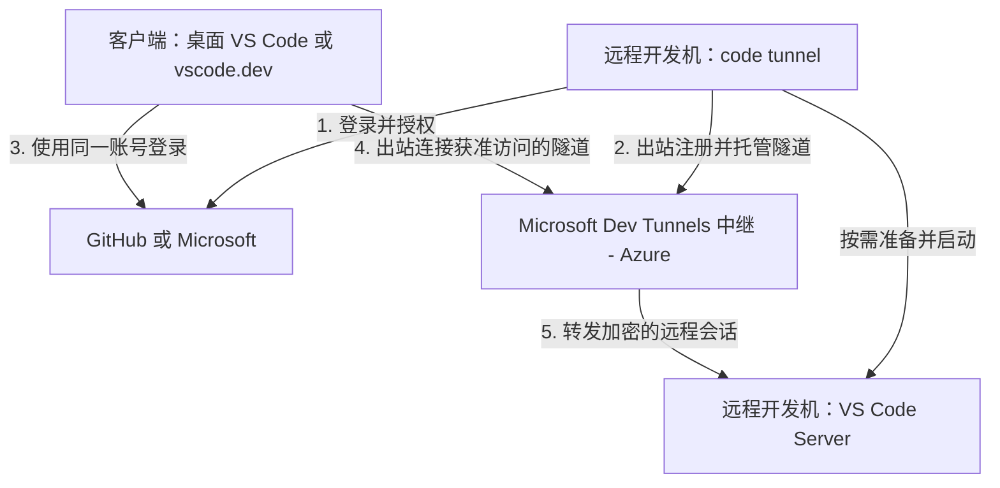
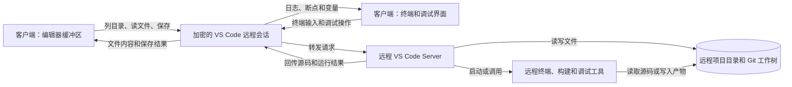
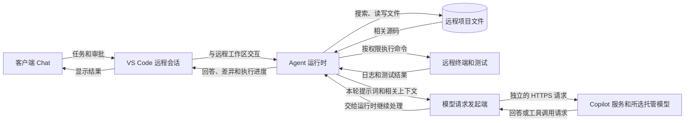

# VS Code Remote Tunnels 使用指南

> 从 VS Code 或浏览器访问远程开发环境，无需自行配置 SSH 服务、VPN 或公网 IP。

---

## 目录

1. [什么是 Remote Tunnels](#1-什么是-remote-tunnels)
   - [连接原理与数据流详解](#连接原理与数据流详解)
2. [环境准备：安装 code CLI](#2-环境准备安装-code-cli)
3. [快速上手](#3-快速上手)
4. [常用命令速查](#4-常用命令速查)
5. [从不同设备连接](#5-从不同设备连接)
6. [后台服务模式](#6-后台服务模式)
7. [管理与安全](#7-管理与安全)
8. [与 Copilot Agent 配合](#8-与-copilot-agent-配合)
   - [四个问题判断数据流](#81-四个问题判断数据流)
   - [Agent 记忆与状态保存位置](#83-agent-记忆与状态保存位置)
9. [故障排查](#9-故障排查)
10. [最佳实践](#10-最佳实践)
    - [多台 Mac 的推荐分工](#多台-mac-的推荐分工)
    - [Tunnel 与直接使用的性能差异](#tunnel-与直接使用的性能差异)

---

## 1. 什么是 Remote Tunnels

Remote Tunnels 是 VS Code 的远程开发功能。**GitHub 或 Microsoft 账号用于身份认证，Azure 上的 Microsoft Dev Tunnels 服务负责中继连接，远程机上的 VS Code Server 负责工作区操作。** 客户端打开的是远程项目，不必先把仓库克隆到本地。

### 核心优势

| 特性 | 说明 |
|------|------|
| 🔐 安全 | 两端用同一 GitHub 或 Microsoft 账号认证，VS Code 远程会话端到端加密 |
| 🚫 无需公网 IP | 远程机器在 NAT/防火墙后面也能用 |
| 🚫 无需自建 SSH | 不用配置 `sshd`、SSH 密钥或入站端口 |
| 🌐 跨设备 | Windows/macOS/Linux 服务端，任意设备客户端 |
| 📱 手机友好 | 平板/手机通过 vscode.dev 连接 |
| ⚡ 远程开发 | 支持远程终端和工作区扩展；Copilot 能力视客户端、版本和组织策略而定 |

### 与其他方案对比

| 方案 | 需自行配置 SSH | 需公网 IP | 需 VPN | 浏览器可用 | 手机可用 | 成本 |
|------|:---:|:---:|:---:|:---:|:---:|:---:|
| **Remote Tunnels** | ❌ | ❌ | ❌ | ✅ | ✅ | 免费 |
| Remote-SSH | ✅ | 不一定 | 不一定 | ❌ | ❌ | 免费 |
| GitHub Codespaces | ❌ | ❌ | ❌ | ✅ | ✅ | 付费 |
| 自建 VPN + SSH | ✅ | ✅ | ✅ | ❌ | ❌ | 需运维 |

### 连接原理与数据流详解

#### 建立连接：身份认证与中继是两回事

<!-- mermaid-checked: no \n, no em-dash/en-dash, no {} in labels, subgraphs are id["label"], arrows are -->|"label"|, all subgraphs closed by end, ids unique -->


两端都向 Azure 服务发起**出站连接**，通常不必修改入站规则。隧道 URL 是入口，不是访问凭证。按 [VS Code 官方说明](https://code.visualstudio.com/docs/remote/tunnels#_how-are-tunnels-secured)，VS Code 在隧道内建立 SSH 连接来保护远程会话；**端到端加密不是仅靠两段到中继的 TLS，也不要求你在远程机上运行 `sshd`**。转发的 Web 预览和 Copilot 请求各有自己的传输和访问规则，不能套用这个结论。

#### 打开、编辑和运行远程项目

<!-- mermaid-checked: no \n, no em-dash/en-dash, no {} in labels, subgraphs are id["label"], arrows are -->|"label"|, all subgraphs closed by end, ids unique -->


| 操作 | 数据走向 |
|------|------|
| 打开目录或文件 | 目录条目和所请求的文件内容从远程机经隧道到客户端。**没有自动克隆整仓，但客户端确实收到了源码文本**，不是只接收远程桌面画面。 |
| 手动编辑并保存 | 输入先更新客户端编辑器缓冲区；保存或自动保存时，写入请求经隧道修改远程磁盘。未保存不等于不可见，例如编辑器选区仍可能作为 Copilot 上下文。 |
| 终端、构建、测试和调试 | 在远程工作区启动时，使用远程环境里的运行时、依赖和路径；输出按需回到客户端。打开浏览器里的 `localhost` 默认还是客户端本机，要访问远程服务需用当前连接支持的[远程浏览或端口访问方式](https://code.visualstudio.com/docs/debugtest/port-forwarding)。 |
| 扩展和语言服务 | 依赖工作区的语言服务通常靠近远程文件运行；客户端除了渲染界面，还维护编辑器状态，并可能运行本地或 Web 扩展。见 [VS Code 扩展宿主说明](https://code.visualstudio.com/api/advanced-topics/extension-host)。 |
| Git 操作 | 在远程终端执行 `git commit`，提交写入远程 Git 仓库；`git push/pull` 则让远程机与 Git 托管服务通信，不是隧道同步。 |

#### 断连与恢复

客户端断开不等于停止远程机上的进程，但终端能否恢复、Agent 是否继续执行，取决于远程机、VS Code Server 或 Agent Host 是否仍在运行，以及工具是否依赖已断开的客户端。重连后先检查任务状态和远程文件；不要假定未保存编辑、终端输出或任务都能自动恢复。

#### 与 Remote-SSH 的本质区别

| 维度 | Remote Tunnels | Remote-SSH |
|------|:---:|:---:|
| **连接发起方** | 双方主动向 Azure 服务出站 | 客户端发起 SSH 连接 |
| **网络要求** | 不需要公网 IP 或入站端口 | 客户端需要能到达 SSH 服务，可经内网、VPN 或跳板机 |
| **中转机制** | Microsoft Dev Tunnels 中继 | 可直连，也可经 SSH 跳板机 |
| **认证方式** | GitHub 或 Microsoft 账号 | 取决于 SSH 服务的认证配置 |

---

## 2. 环境准备：安装 code CLI

### macOS

在 VS Code 中，按 **Cmd + Shift + P** → 搜索并执行 **`Shell Command: Install 'code' command in PATH`**。

或手动创建软链接：

```bash
ln -sf "/Applications/Visual Studio Code.app/Contents/Resources/app/bin/code" /usr/local/bin/code
```

### Windows

安装 VS Code 时勾选「添加到 PATH」，或通过命令面板安装。

### Linux

```bash
# 通过 snap 安装后自动可用
sudo snap install code --classic

# 或手动链接
sudo ln -s /usr/share/code/bin/code /usr/local/bin/code
```

### 验证

```bash
which code    # 应输出 code 的路径
code --version
```

---

## 3. 快速上手

### 3.1 在远程机器上启动隧道

```bash
# 最简单的方式
code tunnel
```

首次使用时按终端提示登录并接受服务端许可条款。若选择 GitHub 且提示设备码，在提示给出的验证页面（如 <https://github.com/login/device>）输入设备码并授权。客户端连接时使用同一个 GitHub 或 Microsoft 账号。

启动成功后会显示：

```
Open this link in your browser: https://vscode.dev/tunnel/<机器名>
```

### 3.2 从另一台设备连接

- **浏览器**：打开 `https://vscode.dev/tunnel/<机器名>`
- **VS Code**：Cmd + Shift + P → **`Remote Tunnels: Connect to Tunnel...`** → 选择目标机器

连接成功后，确认左下角的远程指示器显示目标机器，再通过 **File > Open Folder** 选择远程项目目录。

---

## 4. 常用命令速查

| 命令 | 用途 |
|------|------|
| `code tunnel` | 启动隧道（前台运行） |
| `code tunnel status` | 查看隧道运行状态、连接的客户端数 |
| `code tunnel kill` | 强制关闭隧道 |
| `code tunnel prune` | 清理旧的隧道连接记录 |
| `code tunnel unregister` | 从账号中注销当前设备 |
| `code tunnel service install` | 安装为系统后台服务（开机自启） |
| `code tunnel service uninstall` | 卸载系统后台服务 |
| `code tunnel --help` | 查看所有可用选项 |
| `code tunnel --name <名字>` | 以自定义名称启动 |
| `code tunnel --accept-server-license-terms` | 接受服务端许可条款 |

### 状态示例

```bash
$ code tunnel status

Service is running
  Connected clients: 1
  Service URL: https://abc123.tunnels.api.visualstudio.com
```

---

## 5. 从不同设备连接

### 5.1 通过浏览器（vscode.dev）

适合：手机、平板、临时电脑、不想装 VS Code 的场景。

1. 打开 https://vscode.dev
2. 使用托管隧道时的同一账号登录
3. 点击左下角 → **`Connect to Tunnel...`**
4. 选择目标机器

### 5.2 通过 VS Code 客户端

适合：日常主力开发机。

1. Cmd + Shift + P → **`Remote Tunnels: Connect to Tunnel...`**
2. 选择目标机器
3. 新窗口自动打开，进入远程环境

## 6. 后台服务模式

### 安装为系统服务

让隧道随系统启动自动运行，无需每次手动执行 `code tunnel`：

```bash
code tunnel service install
```

安装后：
- 系统启动 → 隧道自动启动
- 关闭终端不会影响隧道运行
- 等同于「开机自启隧道」

### 卸载服务

```bash
code tunnel service uninstall
```

### 查看服务日志

```bash
# macOS
cat ~/Library/Logs/Visual\ Studio\ Code/tunnel.log

# Linux
cat ~/.vscode-server/tunnel.log
```

---

## 7. 管理与安全

### 7.1 查看已注册设备

在任意 VS Code 中：
1. Cmd + Shift + P → **`Remote Tunnels: View Tunnel Log`** — 查看日志
2. 或在 https://vscode.dev 的连接菜单中查看你的设备列表

### 7.2 注销设备

移除当前账号与该机器的隧道注册关联：

```bash
# 在要注销的设备上
code tunnel unregister
```

或在 VS Code 命令面板中选择 **`Remote Tunnels: Unregister Tunnel...`**。

### 7.3 关闭隧道自动连接

如果从 VS Code 界面启动了隧道，使用 **Remote Tunnels: Turn off Remote Tunnel Access...**。如果安装了后台服务，使用 `code tunnel service uninstall`；如果是前台 CLI，在启动它的终端按 `Ctrl+C`。

### 7.4 安全注意事项

- 默认由托管和连接两端使用同一个 GitHub 或 Microsoft 账号；只从受信任的设备连接，因为所打开的源码会到达客户端。
- VS Code 远程会话的端到端加密，不等于 Copilot 请求或 Web 预览沿用同一安全边界。需要预览开发服务时，检查访问范围，不要公开含敏感数据的端口。
- 停止隧道、注销隧道注册和撤销账号授权是不同操作。`code tunnel unregister` 不等于撤销所有已保存的登录凭证，也不等于取消正在运行的 Agent 任务。

---

## 8. 与 Copilot Agent 配合

### 8.1 四个问题判断数据流

以「用笔记本连接远程开发机，打开项目后让 Copilot 补测试」为例：

| 问题 | 典型答案 |
|------|----------|
| **文件落在哪？** | 项目和 Git 工作树在远程开发机上。打开文件后，客户端有该文件的编辑器缓冲区；保存或 Agent 应用修改后，变更写入目标工作区。如果会话使用单独的 Git worktree 或容器，以会话选中的目录为准。 |
| **工具在哪跑？** | 在远程工作区运行的终端、构建、测试以及该会话的工作区工具，使用远程环境。客户端也运行编辑器逻辑及部分本地或 Web 扩展，可为会话提供工具。MCP 工具要看服务器部署位置；显式选择 **Cloud session** 时，Agent 则在托管环境执行。 |
| **模型请求从哪发？** | 由处理该功能的扩展、Agent 运行时或客户端组件发起，不是 `code tunnel` 自动代发，也不能只凭远程终端的位置推断。实际网络出口取决于功能、版本、会话环境和代理配置；可通过两端的代理或出口日志核对。 |
| **上下文最终发给谁？** | 使用 Copilot 托管模型时，模型请求发到 Copilot 服务并由所选模型处理。BYOK 或受支持的本地模型则按所配置的提供方和部署处理。工具查询、仓库索引和遥测有各自的数据流，不能用模型请求的目的地来概括。 |

### 8.2 补全、Chat 和 Agent 怎么用上下文

- **行内补全**：不打开 Chat 也可能发出请求。光标附近代码和选取的相关上下文可能用于生成建议；接受建议后先更新缓冲区，再由保存流程写入远程文件。
- **Chat 问答**：提示词、选区、引用的文件内容及对话历史可能进入请求。问答不等于保存或修改远程文件。
- **Agent**：可按权限搜索和读文件、修改代码、运行测试；工具结果可能进入下一轮请求。比如测试失败后，相关错误栈、路径、日志，甚至误打印的密钥，都可能成为模型上下文。

下面是 **Agent 在远程工作区调用工具、模型使用 Copilot 托管服务**的典型流程。「模型请求发起端」是逻辑角色，不表示 HTTPS 请求固定从远程机发出。

<!-- mermaid-checked: no \n, no em-dash/en-dash, no {} in labels, subgraphs are id["label"], arrows are -->|"label"|, all subgraphs closed by end, ids unique -->


### 8.3 Agent 记忆与状态保存位置

这里的“记忆”不是单一的数据项，需要区分项目上下文、执行状态、聊天记录和客户端缓存：

| 内容 | 主要位置 | 说明 |
|------|------|------|
| 源码、Git 仓库、终端进程、构建产物 | 远程机器 | Agent 读取和修改的是远程工作区 |
| `copilot-instructions.md`、`.github/` 中的项目指令 | 远程机器 | 这些文件属于项目内容，跟随远程仓库保存 |
| 远程 VS Code Server、扩展和工作区状态 | 远程机器 | 服务器重装或清理相关数据后可能丢失 |
| 当前聊天界面和部分本地缓存 | 客户端或远程会话 | 取决于使用的是桌面 VS Code 还是浏览器客户端 |
| Copilot 账号认证信息 | 客户端和/或远程机器 | 取决于登录方式和 VS Code 的认证状态 |
| Copilot 云端会话及模型请求数据 | GitHub/Copilot 云端 | 具体保留范围受产品和账户策略影响 |

因此，通过 iPad 或另一台电脑连接同一个 Tunnel 时，远程项目、文件、终端和项目指令仍然在服务器上；客户端不会保存一份完整的 Agent 工作区。重新连接后能否恢复完整聊天上下文，则取决于会话是否已由 VS Code 或 Copilot 保存，不能把它简单理解为“全部保存在服务器”或“全部保存在客户端”。

对于长时间任务，建议让任务在远程终端或服务器上的独立进程中运行，并使用 `tmux`、`screen` 或后台服务管理。仅依赖当前客户端前台会话的任务，在客户端断开、VS Code Server 重启或认证失效时，可能无法继续。

### 8.4 不要把隧道加密当成 AI 数据隔离

- **远程会话**：打开文件和回传终端输出走加密隧道；这不会自动触发 Copilot 上传。
- **模型推理**：每轮使用选取的上下文，不是每次把整个仓库发给模型，也不一定只用当前文件。
- **语义索引**：支持的托管仓库可以使用已有索引。如果账号策略和工作区设置允许使用 **External ingest**，可索引文件可能另行上传到 GitHub。这与单次推理请求是两条链路。
- **敏感文件**：`.gitignore` 和 [Copilot 内容排除](https://docs.github.com/en/copilot/concepts/security-governance-and-network-settings/content-exclusion)不能当作文件系统权限。打开或选中被忽略的文件仍可能提供上下文；内容排除对远程文件系统、符号链接及第三方工具有适用限制。敏感文件应靠权限隔离；有禁止外发要求的工作区，应通过组织策略限制托管 AI 和外部索引。

参考：[VS Code 工作区上下文与语义索引](https://code.visualstudio.com/docs/agents/reference/workspace-context) · [Agent Host 架构](https://code.visualstudio.com/docs/agents/concepts/agent-host) · [Copilot 网络端点](https://docs.github.com/en/copilot/reference/copilot-allowlist-reference)

### 8.5 在自己的环境中验证

1. 在远程窗口的终端运行 `hostname` 和 `pwd`，核对远程机或容器及项目目录。也可以让 Agent 用只读命令报告位置，确认该会话使用的是预期环境。
2. 保存一个无敏感内容的测试文件，再从远程机的独立终端检查文件内容或运行 `git diff`，确认写入位置。
3. 用无敏感样例发起一轮 Chat，查看 [Chat Debug View](https://code.visualstudio.com/docs/agents/agent-troubleshooting/chat-debug-view) 中记录的模型请求、上下文和工具结果。若要确认是谁发起出站请求，再按时间对照本地和远程代理或出口日志；不要公开共享可能含源码的调试记录。

### 8.6 网络不稳定时的表现

- **已独立运行的任务**：远程终端进程、后台服务或已脱离客户端的任务通常会继续执行
- **依赖前台会话的任务**：可能因客户端断开、Server 重启或进程退出而中止
- **恢复连接**：远程工作区仍在服务器上；编辑器标签页、终端输出和聊天上下文能否完整恢复，取决于具体客户端及会话保存状态
- **建议**：长时间任务先确认网络环境稳定

### 8.7 典型场景

| 场景 | 方案 |
|------|------|
| iPad 在地铁上改代码 | iPad 浏览器 → vscode.dev → 隧道连办公室电脑 |
| 家里笔记本性能弱 | 轻薄本 → 隧道连公司高性能服务器 |
| 临时查看代码 | 手机浏览器 → vscode.dev → 隧道连开发机 |

---

## 9. 故障排查

### 9.1 code 命令找不到

```bash
which code     # 若无输出，需要安装 code CLI（见第 2 章）
```

### 9.2 隧道无法启动

```bash
# 查看详细日志
code tunnel --verbose

# 检查是否有旧进程
ps aux | grep code-tunnel
kill <PID>          # 清理后重试
```

常见原因：
- 网络不通（根据 [Dev Tunnels 网络要求](https://learn.microsoft.com/azure/developer/dev-tunnels/security#domains)检查两端的出站访问）
- 隧道登录已过期（按 CLI 或 VS Code 的提示重新认证）
- 旧版本 VS Code（更新到最新版）

### 9.3 客户端连接失败

- 确保使用**托管隧道时的同一 GitHub 或 Microsoft 账号**连接
- 检查远程机器隧道是否在运行：`code tunnel status`
- 检查是否在同一账号下：在 vscode.dev 确认设备列表

### 9.4 更新 VS Code Server

```bash
# VS Code 客户端更新后，server 会自动更新
# 如需强制更新：
code tunnel prune    # 清理旧的 server
code tunnel          # 重新启动，自动下载最新 server
```

---

## 10. 最佳实践

### 多台 Mac 的推荐分工

如果同时拥有 Mac mini M4 Pro、iMac 2019 和 MacBook Pro 2019，建议采用“一台主服务器、一台兼容性服务器、多台客户端”的布局：

| 设备 | 推荐角色 | 适合用途 |
|------|------|------|
| Mac mini M4 Pro | 主力 Tunnel Server | 日常开发、Copilot Agent、编译、Docker、数据库和长时间任务 |
| iMac 2019 | Intel 兼容性 Server | Intel-only 工具、旧项目、x86 容器和 macOS Intel 兼容性测试 |
| MacBook Pro 2019 | 移动客户端 | 通过 Tunnel 操作远程工作区，减少本机依赖安装和重编译 |
| 另一台 MacBook Pro 2019 | 备用客户端或测试客户端 | 代码审查、文档处理、临时连接和不同客户端验证 |

在两台服务器上使用清晰且唯一的名称：

```bash
# 在 Mac mini M4 Pro 上
code tunnel --name mac-mini-m4

# 在 iMac 2019 上
code tunnel --name imac-intel
```

日常开发优先连接 `mac-mini-m4`；需要验证 Intel 行为或运行旧工具链时，再从 MacBook 连接 `imac-intel`。项目的主工作区尽量集中在 Mac mini 的 `~/Projects/` 下，不要在多台设备上同时维护正在编辑的副本，以免产生依赖、环境变量和未提交修改分叉。

### 远程主机的运行条件

作为主 Server 的 Mac mini 应保持联网和供电，优先使用有线网络，并在 macOS 的节能设置中避免自动睡眠。Server 进入睡眠后，Tunnel、远程终端和长时间 Agent 任务都可能暂停或断开。两台服务器都建议安装后台服务：

```bash
code tunnel service install
```

对于构建、测试、部署等长任务，使用 `tmux`、`screen` 或后台服务，使任务不依赖当前 MacBook 的前台连接：

```bash
tmux new -s project
# 在会话中运行构建或测试
tmux attach -t project
```

### Tunnel 与直接使用的性能差异

通过 Tunnel 连接 Mac mini 时，Mac mini 的 CPU、内存、SSD、编译和 Docker 性能不会因为远程连接而降低；主要增加的是输入、文件内容和终端输出在网络中的往返时间。直接使用 Mac mini 的延迟最低，Tunnel 的体验则取决于客户端网络、Mac mini 的上行带宽、网络抖动以及 Tunnel 中继路径。

| 操作 | 直接使用 Mac mini | 通过 Tunnel | 影响 |
|------|------|------|------|
| 编译、测试、打包 | 使用 Mac mini 本机性能 | 仍在 Mac mini 上执行 | 通常几乎没有差距 |
| Docker、数据库和脚本 | 本机执行 | 仍在 Mac mini 上执行 | 通常几乎没有差距 |
| 打开小文件、代码浏览 | 即时 | 有少量网络等待 | 通常可接受 |
| 终端输入和实时输出 | 即时 | 受往返延迟影响 | 高延迟时明显 |
| 大文件、超大日志和大量文件刷新 | 本地读取 | 需要通过网络传输 | 可能明显变慢 |
| 图形界面和交互式调试 | 最流畅 | 对延迟和丢包敏感 | 建议直接操作 |

可以用往返延迟（RTT）粗略判断交互体验：

| RTT | 体验参考 |
|------|------|
| 小于 50 ms | 接近本地使用 |
| 50 至 100 ms | 日常编码通常舒适 |
| 100 至 200 ms | 可以工作，但终端和滚动开始有延迟 |
| 大于 200 ms | 适合轻量修改和查看，不适合高频交互 |

即使客户端和 Mac mini 在同一局域网内，Remote Tunnel 也不应默认当作局域网直连；实际路径和延迟以连接环境为准。Mac mini 使用有线网络通常比 Wi-Fi 更稳定，但不会消除 Tunnel 中继带来的额外往返时间。

建议按工作类型选择连接方式：日常 Web、后端、脚本开发、Agent、编译和自动化测试优先使用 Tunnel；图形调试、大文件操作、USB/iOS 设备调试或网络质量不稳定时，直接使用 Mac mini。长任务启动后主要消耗 Mac mini 的计算资源，适合放入 `tmux`、`screen` 或后台服务中运行。

如需在自己的网络环境中比较，可分别直接在 Mac mini 和通过 Tunnel 执行同一个构建或测试命令，并记录两类时间：命令实际完成所需的“计算时间”，以及打开文件、输入终端和看到输出所需的“交互等待时间”。前者通常接近，后者才是 Tunnel 的主要差异。

### ✅ 推荐做法

1. **高性能机器做 Server**：把开发放在性能最好的机器上，用轻薄本/平板连接
2. **安装后台服务**：`code tunnel service install`，省去每次手动启动
3. **自定义机器名称**：`code tunnel --name office-mac`，方便多台机器识别
4. **定期清理**：`code tunnel prune` 清理过期连接
5. **长期不用就注销**：`code tunnel unregister` 保持设备列表整洁

### ⚠️ 注意事项

1. **不要在公共网络下无人值守**：虽然安全，但物理访问风险依然存在
2. **大文件操作注意**：远程文件操作走网络，大文件传输会比本地慢
3. **先确认终端和工作区位置**：在远程终端执行的 Git 命令操作远程工作树
4. **保持 VS Code 更新**：客户端和远程 Server 版本匹配才能获得最佳体验
5. **网络要求**：建议上行带宽 ≥ 2 Mbps，延迟 < 200ms

### 🔄 工作流推荐

```bash
# 早晨到办公室
# 隧道已自动启动（已安装 service）

# 中午外出，用 iPad
# 打开 vscode.dev → Connect to Tunnel → 继续工作

# 回到家，用笔记本
# VS Code → Remote Tunnels → 连上继续写代码

# 周末关闭隧道
code tunnel kill        # 或用 Ctrl+C
# 或直接关机，隧道自动关闭
```

---

## 附录：快速参考卡片

| 操作 | 命令 |
|------|------|
| 启动隧道 | `code tunnel` |
| 自定义名称 | `code tunnel --name my-mac` |
| 查看状态 | `code tunnel status` |
| 强制关闭 | `code tunnel kill` |
| 注销设备 | `code tunnel unregister` |
| 安装后台服务 | `code tunnel service install` |
| 卸载后台服务 | `code tunnel service uninstall` |
| 清理旧记录 | `code tunnel prune` |
| 客户端连接 | `vscode.dev/tunnel/<name>` |
| VS Code 内连接 | `Remote Tunnels: Connect to Tunnel` |
| 关闭隧道托管 | 界面选择 **Turn off Remote Tunnel Access**；前台 CLI 按 `Ctrl+C`；后台服务用 `code tunnel service uninstall` |
