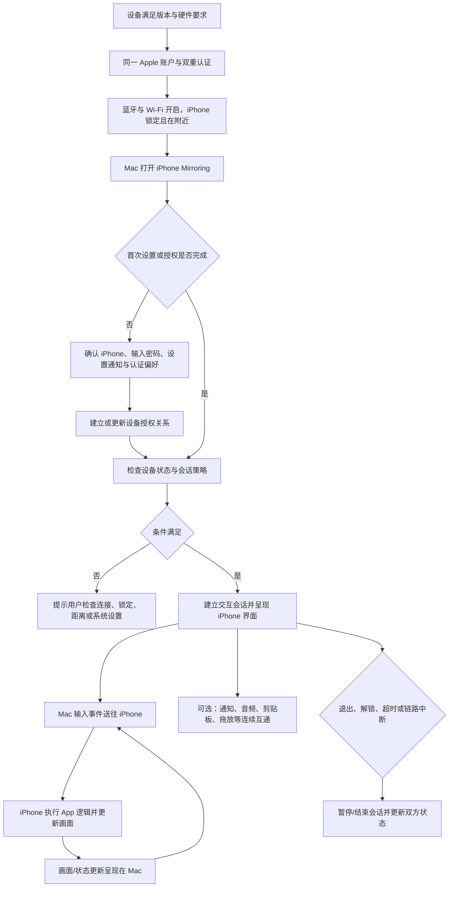
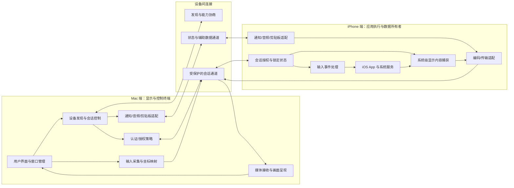
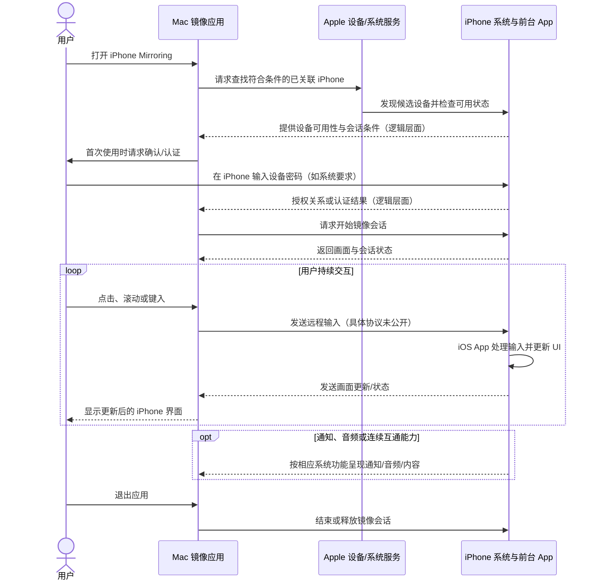

# iPhone 镜像应用实现原理与完整工作流程

> **研究日期**：2026 年 10 月 18 日  
> **讨论对象**：Apple 的 iPhone Mirroring（中文常称“iPhone 镜像”）功能，以及开发者自行实现类似“手机画面投到电脑、并可反向操控”产品时可借鉴的系统设计。  
> **重要说明**：Apple 没有公开 iPhone Mirroring 的内部协议、视频编码格式、传输通道划分或具体进程架构。本文把 Apple 官方明确公布的行为与基于产品现象推导出的通用架构分开描述；推导部分不代表 Apple 的实现细节。

## 目录

1. [先给结论：它是什么，不是什么](#1先给结论它是什么不是什么)
2. [从用户角度看，完整流程是什么](#2从用户角度看完整流程是什么)
3. [系统内部可以怎样理解](#3系统内部可以怎样理解)
4. [一次镜像会话的时序](#4一次镜像会话的时序)
5. [画面、输入、音频与通知分别如何流动](#5画面输入音频与通知分别如何流动)
6. [安全与隐私边界](#6安全与隐私边界)
7. [自己实现类似产品，需要哪些模块](#7自己实现类似产品需要哪些模块)
8. [性能、可靠性与工程难点](#8性能可靠性与工程难点)
9. [与 AirPlay、屏幕共享和远程控制的区别](#9与-airplayscreen-sharing和远程控制的区别)
10. [常见误解与排错思路](#10常见误解与排错思路)
11. [总结：用一条链路记住原理](#11总结用一条链路记住原理)
12. [参考资料](#12参考资料)

## 1. 先给结论：它是什么，不是什么

### 1.1 一句话说明

**iPhone 镜像不是把 iPhone 的画面简单投到 Mac 上，而是让 Mac 在经过身份验证和授权后，成为 iPhone 的远程显示与输入终端。** iPhone 仍在运行 App、处理触摸事件、访问本机数据；Mac 负责显示远端画面、把鼠标键盘操作送回 iPhone，并在适用时承接音频、通知和跨设备内容交互。

可以用“远程桌面”作粗略类比，但它不是通用 VNC，也不是面向第三方开发者的公开控制 API。Apple 的官方产品说明确认：iPhone 保持锁定，用户可从 Mac 与 iPhone App 交互；Mac 的鼠标/触控板和键盘可操作镜像窗口；iPhone 音频可经 Mac 播放；相机与麦克风不通过该镜像功能提供访问。

### 1.2 四个关键区分

| 容易混淆的概念 | 更准确的理解 |
|---|---|
| 镜像窗口里的画面 | 来自 iPhone 当前界面的远端呈现，不是 Mac 本地运行了同一款 iOS App。 |
| 鼠标点击 | 在交互意义上对应 iPhone 上的触摸/按压操作；不是 Mac 在本地模拟 iOS UI。 |
| 蓝牙和 Wi‑Fi | Apple 公布它们必须开启，但没有公开镜像媒体数据具体使用哪种链路、协议或编码。不能据此断言“视频一定走 Wi‑Fi、蓝牙只做发现”。 |
| Apple 账户与配对 | 相同 Apple 账户、双重认证、设备邻近等是使用前提；它们是设备关系与授权条件，不意味着镜像视频经 iCloud 中转。 |

### 1.3 官方事实与架构推断的边界

本文会用以下标签避免把推断误当事实：

- **【Apple 明确说明】**：Apple 支持文档直接描述的要求或行为。
- **【通用架构模型】**：解释此类产品通常如何分层，便于开发者理解；不表示 Apple 内部采用了相同组件。
- **【未公开】**：Apple 没有公开足够细节，本文不猜测具体实现。

## 2. 从用户角度看，完整流程是什么

### 2.1 建立可用的设备关系

使用前，Mac 与 iPhone 需要满足版本和设备要求。Apple 当前支持文档列出的基线包括：Mac 使用 macOS Sequoia 15 或更新版本，且为 Apple 芯片或搭载 Apple T2 安全芯片的机型；iPhone 使用 iOS 18 或更新版本并设置了锁屏密码；两台设备登录同一个启用了双重认证的 Apple 账户；两台设备均开启蓝牙和 Wi‑Fi；iPhone 锁定并位于 Mac 附近。当前地区可用性和部分行为可能随系统版本、地区与 Apple 后续更新变化。

### 2.2 首次设置与信任确认

首次打开 Mac 上的 iPhone Mirroring 应用时，系统需要确认要连接哪台 iPhone，并完成访问授权。首次流程可能包含：

1. 在 Mac 打开 iPhone Mirroring。
2. 选择或确认附近、符合条件的 iPhone。
3. 按提示在 iPhone 上输入设备密码，以确认设备在场并由用户解锁授权。
4. 决定 Mac 是否接收 iPhone 通知。
5. 决定以后每次连接是否都要进行 Mac 登录认证，或使用自动认证选项。
6. 建立设备之间的镜像授权关系。

这是“信任建立”阶段，不应与每一帧画面的传输混为一谈。Apple 允许用户之后撤销某台 Mac 对 iPhone 的镜像访问。

### 2.3 启动会话

完成设置后，用户从 Mac 打开镜像应用。系统检查设备关系、附近状态、锁定状态、无线连接条件与访问策略；通过后，在 Mac 上显示 iPhone 当前界面。iPhone 屏幕保持锁定，iPhone 会提示正在被使用，并可查看是哪台 Mac 使用过它。

### 2.4 交互与同步

用户在 Mac 窗口点击、滚动或键入。Mac 将操作转换为适合 iPhone 界面的输入；iPhone 处理事件、更新 UI 并生成新的显示内容；Mac 收到更新后重绘窗口。用户还可在支持的场景使用通知跳转、通用剪贴板、拖放和 AirDrop 等连续互通能力。它们是相关但不完全相同的数据通路，不应简单理解为“全部都装在一条视频流里”。

### 2.5 暂停、结束与恢复

会话可能因用户主动退出、iPhone 解锁、长时间无操作、设备离开有效范围、无线连接变化或系统策略而暂停或结束。Apple 明确表示镜像会在一段时间无操作后自动暂停；结束方式包括退出 Mac 上的镜像应用或解锁 iPhone。实际恢复时机和连接重试行为会受系统版本与状态影响。

### 2.6 全流程总览



## 3. 系统内部可以怎样理解

Apple 未发布其内部组件图。为了理解职责，可把同类系统抽象为以下逻辑层；这是**概念模型**，不是 Apple 官方组件名称。



### 3.1 Mac 端：负责“呈现”和“输入代理”

概念上至少要有窗口界面、画面解码/呈现、键鼠事件采集、显示比例换算、设备会话状态，以及系统通知等功能入口。Mac 并不负责执行 iOS App 的业务逻辑；App 仍然在 iPhone 上运行。

### 3.2 iPhone 端：负责“执行”和“数据控制”

iPhone 是应用执行端和数据源。它继续运行前台 iOS App，处理触摸等输入、权限检查、系统 UI、数据访问和状态变化，再把适合远端呈现的画面更新提供给镜像会话。具体由哪些系统进程完成、是否存在独立编码服务，Apple 未公开。

### 3.3 会话与媒体不一定是一条通道

【通用架构模型】一个成熟的远程交互系统通常会分出不同逻辑职责：

- **控制面**：发现设备、协商能力、创建/结束会话、同步状态、处理重连。
- **媒体面**：发送画面更新；可能还包含音频。
- **输入面**：把键盘、指针或触摸操作映射到远端设备。
- **辅助数据面**：通知、剪贴板、拖放等内容。

实际实现可复用底层传输，也可拆成多个通道。**Apple 没有公开 iPhone Mirroring 的通道、协议或端到端加密细节，因此不能把这一模型当作其协议说明。**

## 4. 一次镜像会话的时序

以下时序说明的是产品层面的合理工作过程；具体消息格式、重试算法和网络协议均未公开。



### 阶段 A：发现与资格检查

系统需要找到用户允许使用的设备，并判断系统版本、账户关系、附近状态、蓝牙/Wi‑Fi 状态及当前系统条件是否满足。Apple 公开的是用户可见的前置条件，而不是设备发现协议和服务名称。

### 阶段 B：认证与授权

首次设置需要建立信任；后续连接可根据用户选择再次认证或自动认证。这里需要区分“设备身份/访问授权”和“解锁 iPhone”：iPhone 镜像正常工作时仍保持锁定，并不等同于把解锁后的手机交给 Mac 使用。自动认证偏好也不代表可以绕过 Mac 登录安全设置。

### 阶段 C：创建会话并显示首帧

会话建立后，Mac 窗口开始呈现 iPhone 画面。首次画面建立的延迟、帧率、分辨率和压缩算法没有官方公开数值；它们会受硬件、系统版本、无线环境、内容复杂度和电源状态等因素影响。

### 阶段 D：交互闭环

每次输入可以概括为：

```text
Mac 鼠标/键盘事件
    -> 窗口坐标转换为 iPhone 界面坐标或语义操作
    -> 受授权的远端输入处理
    -> iPhone App / iOS 处理
    -> iPhone 界面状态变化
    -> 新画面或更新送回 Mac
    -> Mac 窗口刷新
```

这个闭环是“可交互镜像”的核心。单向投屏只有从手机到显示器的媒体输出；远程控制额外需要反向输入、授权和状态管理。

## 5. 画面、输入、音频与通知分别如何流动

### 5.1 画面：手机执行，Mac 显示

用户看到的画面对应 iPhone 上的真实 App 状态。一般远程显示系统会尽量只传变化区域或压缩后的媒体，而不是每次都传整张未压缩屏幕；但 Apple 没有说明 iPhone Mirroring 使用何种捕获方式、编码器、编解码器、帧率或是否采用差分传输，不能把行业常见实现写成 Apple 的既定事实。

窗口调整大小、手机方向变化、应用切换或系统提示出现，都可能触发画面布局或呈现状态变化。Apple 文档确认镜像视图会随 App 需要在横屏与竖屏之间切换。

### 5.2 输入：坐标映射与远端事件处理

Mac 的指针坐标属于 Mac 窗口坐标系，iPhone 界面则有自己的逻辑尺寸和方向。通用实现必须处理：

- 窗口缩放、显示比例和设备安全区域之间的映射；
- 点击、长按、滚动、左右滑动等手势语义；
- 键盘输入、快捷键、输入法与文本编辑状态；
- 横竖屏切换时坐标变换；
- 连接延迟时的输入顺序和反馈状态。

Apple 官方说明支持使用 Mac 鼠标/触控板点击、长按、滚动/滑动，并使用 Mac 键盘输入及快捷键；至于内部事件如何编码和注入，未公开。

### 5.3 音频与视频

Apple 说明 iPhone 音频可从 Mac 播放，音量由 Mac 控制，除非用户正在使用连接到 iPhone 的耳机；视频内容可在镜像窗口播放。但流媒体提供商的内容保护规则可能限制部分高级视频内容镜像。

**相机与麦克风不是镜像转发的外设**：Apple 明确说明 iPhone Mirroring 不提供对 iPhone 相机和麦克风的访问，包括 Face ID 和电话场景。需要打电话时可使用 Apple 的 Mac/iPhone 通话连续互通功能，它与镜像会话不是同一功能。

### 5.4 通知与实时活动

首次连接后，用户可允许 Mac 接收 iPhone 通知；通知功能与镜像窗口本身并非完全绑定。Apple 当前文档还说明，设置完成后，iPhone 通知可在镜像应用未打开、甚至 iPhone 不在附近时送到 Mac（iPhone 需开机），并可按设备或 App 管理。点击适用通知且 iPhone 在附近时，可在镜像中打开相关 App。

因此，更准确的模型是：镜像会话建立了设备间功能授权，通知有自己的持续性系统能力；不要假设每个通知都是从当前视频会话里“顺带传过来”。

### 5.5 剪贴板、拖放与 AirDrop

Apple 文档列出拖放、通用剪贴板和 AirDrop 等跨设备复制内容的方式。它们依赖连续互通能力和各自的用户交互/权限语义，不等于所有文件都通过镜像媒体连接传输。实现同类产品时，应该把“传屏”“输入控制”和“文件/剪贴板同步”当作独立能力设计，分别定义权限、确认提示和数据生命周期。

## 6. 安全与隐私边界

### 6.1 锁定状态是重要的产品约束

镜像时 iPhone 保持锁定，iPhone 会告知用户设备正在使用，且能识别正在使用它的 Mac；在用户之后解锁 iPhone 时，也可查看近期镜像使用信息。这提供了设备侧可见性，降低“电脑上开着一个隐蔽远控窗口”的风险。

### 6.2 授权可撤销，认证策略可配置

用户可选择每次连接都认证，或按系统支持启用自动认证；也可撤销某台 Mac 的镜像访问。开发类似功能时，信任关系应支持按设备撤销、过期、重新认证和审计，而不应只依赖一次配对后永久有效。

### 6.3 需要明确的权限边界

镜像权限不等于拥有 iPhone 全部硬件和系统能力。Apple 明确将相机、麦克风排除在镜像访问之外；Face ID 与电话也不是通过镜像窗口直接远控。购买、支付、凭据、受 DRM 保护的内容和敏感系统界面还可能受 iOS 权限、App 策略或内容提供方限制。

### 6.4 传输安全的准确说法

必须开启蓝牙和 Wi‑Fi 是 Apple 公布的要求，但并不能推导出内部媒体链路一定如何加密、使用哪种无线接口或是否经过某类云服务。本文不对协议、密钥交换或端到端加密作未经官方证实的断言。若评估安全性，应以 Apple 当前平台安全文档、明确的产品声明和实际威胁模型为准，而不是从“同一账户”或“附近连接”推测技术细节。

### 6.5 自行开发产品时的最低安全要求

如果要实现自己的手机远程显示产品，至少要设计：

1. **强身份绑定**：设备身份、用户账户和配对关系明确绑定。
2. **显式授权**：首次配对、敏感操作和权限提升有清晰确认。
3. **设备端可感知**：屏幕提示、状态指示、会话列表和远端断开入口。
4. **可撤销访问**：可单独撤销某台电脑或某个会话的权限。
5. **安全会话**：认证、加密、密钥轮换、重放防护和断线后的安全恢复。
6. **最小权限**：默认不开放相机、麦克风、文件、通知等非必需能力。
7. **数据最小化**：尽量不持久化画面、剪贴板或用户输入；日志脱敏并设保留期限。
8. **平台合规**：使用操作系统允许的屏幕捕获、辅助功能和输入 API；不尝试绕过系统沙箱或安全提示。

## 7. 自己实现类似产品，需要哪些模块

### 7.1 产品能力分层

| 模块 | 主要职责 | 关键设计问题 |
|---|---|---|
| 设备配对 | 让手机与电脑建立可信关系 | 如何确认双方身份、撤销设备、处理换机？ |
| 会话控制 | 启动、暂停、恢复和结束远程会话 | 前后台切换、休眠、断线超时如何处理？ |
| 屏幕捕获 | 从手机系统获取允许捕获的画面 | 是否受系统权限、隐私窗口和受保护内容限制？ |
| 媒体编码与传输 | 控制带宽和延迟 | 码率、分辨率、帧率和网络抖动如何自适应？ |
| 桌面端呈现 | 解码、缩放和显示手机画面 | 如何适配高 DPI、多屏幕、窗口缩放与旋转？ |
| 远端输入 | 将鼠标/键盘/触控转换为手机事件 | 目标平台是否允许注入输入？是否需要特殊权限？ |
| 音频 | 采集、传送、播放与路由 | 回声、延迟、蓝牙耳机和权限如何处理？ |
| 连续互通 | 通知、剪贴板、拖放和文件传输 | 每种数据如何单独授权、确认和审计？ |
| 诊断与可观测性 | 连接状态、延迟、丢包和错误提示 | 怎样帮助用户定位“找不到设备”与“画面卡顿”？ |

### 7.2 关键平台限制

在 iOS 上，第三方应用可用的系统接口受到沙箱、隐私权限和 App Store 政策约束。公开 API 可支持的屏幕广播与采集能力，不自动等于能在任意场景下捕获所有系统界面，更不等于可任意注入系统级触摸事件、启动任意其他 App 或复制 Apple 的系统级体验。**iPhone Mirroring 是 Apple 自有系统功能；普通 App 开发者不能假定存在一套公开 API，可直接复刻其完整控制能力。**

因此，项目开始前先验证目标平台许可的能力边界，而不是先写传输协议。Android、iOS、macOS、Windows 在捕获、输入、后台运行和权限模型上都不同，跨平台产品通常需要平台专用实现。

### 7.3 推荐的实现顺序

1. 定义只读投屏还是可交互远控，先收紧产品范围。
2. 验证目标系统公开 API 是否允许必要的捕获、后台运行和输入操作。
3. 建立配对、授权、撤销和用户可见的会话状态。
4. 做局域网最小原型，先测端到端延迟和网络恢复。
5. 再添加自适应画质、音频、通知、剪贴板和文件能力。
6. 进行权限滥用、恶意配对、重放、会话劫持和敏感信息泄露测试。
7. 针对不同系统版本与设备建立兼容性矩阵。

## 8. 性能、可靠性与工程难点

### 8.1 端到端延迟

交互体验由多段延迟组成：事件采集、网络发送、手机处理、画面捕获/编码、网络返回、桌面解码与呈现。可以用下式理解总延迟：

$$
T_{e2e}=T_{input}+T_{uplink}+T_{render}+T_{capture/encode}+T_{downlink}+T_{decode/display}
$$

这只是通用性能分解，不是 Apple 发布的测量值。低延迟并不只靠提高帧率；降低排队、及时丢弃过时帧、限制缓冲、按网络状态调整质量，通常同样重要。

### 8.2 网络抖动与画质

无线网络带宽会变化。工程上需要在画面清晰度、帧率、延迟和功耗之间动态取舍，并对短暂丢包、切换接入点、蓝牙/Wi‑Fi 干扰和设备休眠进行处理。Apple 支持文档也建议在无线连接异常时检查网络使用冲突和无线干扰。

### 8.3 坐标、方向与输入一致性

窗口缩放和横竖屏旋转会改变坐标映射；输入已发送但画面尚未更新时，用户可能重复点击。可靠方案要保持事件顺序、显示输入反馈并处理断线期间的未完成操作；涉及交易或破坏性操作时，不能因为远端重试而产生重复副作用。

### 8.4 电量、热量与前后台

持续捕获、编码、无线发送和屏幕呈现都消耗电量并产生热量。产品应遵守系统后台运行限制，并根据设备温度、充电状态和电量调整质量或暂停会话。Apple 官方要求 iPhone 锁定且靠近 Mac，并指出设备若正将 Wi‑Fi/蓝牙用于其他高负载场景，可能影响连接。

### 8.5 错误状态要能解释

“连接失败”最好拆成可操作的类别：版本/机型不兼容、设备未登录同一账户、双重认证未开启、蓝牙/Wi‑Fi 关闭、手机未锁定或距离过远、授权被撤销、VPN/防火墙阻拦、连接超时、设备忙碌或系统功能不可用。不要只显示一个没有上下文的“未知错误”。

## 9. 与 AirPlay、屏幕共享和远程控制的区别

| 能力 | 主要目标 | 通常的交互方式 | iPhone 是否仍是执行端 |
|---|---|---|---|
| iPhone Mirroring | 从 Mac 查看并交互使用 iPhone 与其 App | Mac 显示窗口并回传鼠标/键盘操作 | 是 |
| AirPlay 屏幕镜像 | 把 iPhone 画面显示到兼容电视或 Mac | 主要由 iPhone 发起选择接收端；目标是内容呈现 | 是，但不等于完整远程控制 |
| 远程桌面/VNC | 远程操作一台具备远程服务的电脑 | 远端画面加输入回传 | 取决于被控设备 |
| 视频投放 | 把某个视频交给接收设备播放 | 接收端可能自行拉取/解码媒体 | 视应用和协议而定 |
| 设备间剪贴板 | 在附近 Apple 设备间复制粘贴 | 通过连续互通能力同步短期内容 | 不依赖镜像窗口持续打开 |

Apple 的支持文档把 AirPlay 描述为向 Apple TV、兼容电视或 Mac 流传视频/镜像屏幕；iPhone Mirroring 则提供 Mac 上与 iPhone App 交互的体验。两者都可能涉及“画面到另一台设备”，但产品目的、输入能力和用户授权流程不同。

## 10. 常见误解与排错思路

### 10.1 “只要同一个 Apple 账户，视频就会经 iCloud 转发”

不成立。Apple 账户是资格与设备关系条件，官方资料没有说明镜像媒体经过 iCloud。不要把账户同步服务和实时媒体链路等同起来。

### 10.2 “蓝牙开启就说明画面走蓝牙”

不成立。Apple 要求蓝牙和 Wi‑Fi 均开启，但没有公开具体数据通道。蓝牙开启是先决条件，不足以推断画面传输介质。

### 10.3 “这就是 AirPlay 加一个鼠标层”

过度简化。镜像涉及设备授权、锁定状态、系统级交互、输入回传、通知策略和会话生命周期。即使底层有共享的系统能力，Apple 也没有公开其内部是否复用 AirPlay 协议。

### 10.4 “第三方 App 可以完全复制 Apple 的镜像功能”

不能这样假设。第三方 App 能做什么取决于系统公开 API、用户授权、后台执行规则、输入控制限制和商店政策。必须逐平台验证，不能通过私有 API 或绕过安全机制实现。

### 10.5 快速排查顺序

1. 检查 Mac/iPhone 系统版本和 Mac 硬件支持情况。
2. 确认两台设备使用同一 Apple 账户，且已启用双重认证。
3. 确认两端蓝牙和 Wi‑Fi 已开启，iPhone 锁定并靠近 Mac。
4. 确认没有处于与镜像不兼容的网络共享、AirPlay 或 Sidecar 使用状态。
5. 更新并重启两台设备，暂时排除无线干扰、VPN 或第三方安全软件。
6. 在镜像设置中撤销该 iPhone 的 Mac 访问，再重新设置。
7. 如果只是不接收通知，单独检查 Mac 通知设置和 iPhone 对应 App 的“在 Mac 上显示”选项。

## 11. 总结：用一条链路记住原理

```text
设备资格与账户关系
    -> 首次认证和设备授权
    -> 建立受系统管理的会话
    -> iPhone 继续运行 App 并产生界面状态
    -> Mac 显示远端画面
    -> Mac 输入事件回到 iPhone
    -> iPhone 处理并更新画面
    -> 通知、音频、剪贴板等按各自系统能力协作
    -> 用户退出、解锁、超时或链路异常时结束/暂停会话
```

最重要的理解是：**iPhone Mirroring 把 iPhone 当作应用执行端，把 Mac 当作受授权的远程交互终端；Apple 公开了用户可见的工作条件和行为，但没有公开内部协议与媒体管线。**理解工作流程足以解释其产品体验，也足以规划类似功能的系统模块；若要做真正的第三方实现，必须先验证平台 API 与权限边界。

## 12. 参考资料

1. Apple 支持：《[iPhone Mirroring: Use your iPhone from your Mac](https://support.apple.com/en-us/120421)》：系统要求、设置和认证选项、交互方式、隐私、音频/视频、剪贴板和故障排除。页面内容可能随系统版本更新。
2. Apple 支持：《[Manage iPhone notifications and Live Activities on Mac](https://support.apple.com/en-us/120684)》：镜像设置后的通知与实时活动行为、通知管理和设备撤销方式。
3. Apple 支持：《[Use AirPlay to stream video or mirror the screen of your iPhone or iPad](https://support.apple.com/en-us/102661)》：AirPlay 流媒体及屏幕镜像的用户流程。
4. Apple 支持：《[Use Universal Clipboard to copy and paste between your Apple devices](https://support.apple.com/en-us/102430)》：通用剪贴板所需的设备关系和使用方式。
5. Apple：《[Apple Platform Security](https://support.apple.com/guide/security/welcome/web)》：Apple 平台硬件、系统、数据保护、App 与服务安全资料。该指南提供平台安全背景，不等同于 iPhone Mirroring 内部协议说明。

> **资料边界**：本文以 Apple 用户支持文档可验证的要求和行为为事实依据。对于设备发现协议、网络拓扑、视频编解码、传输加密实现、内部系统服务和私有 API，Apple 未在上述公开资料中给出足够细节，本文不作确定性推断。
